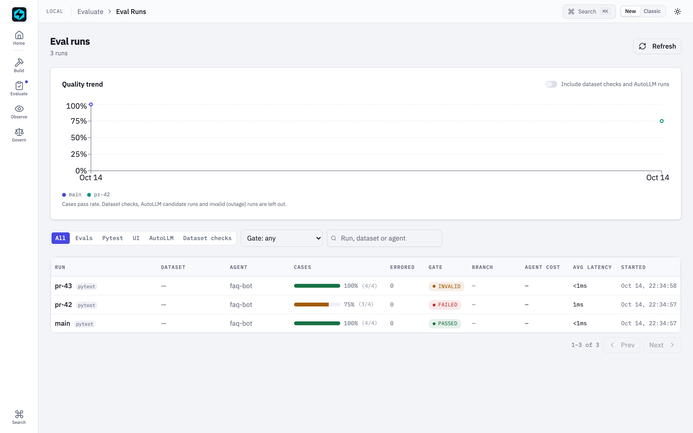

# Agent CI — gate every change on agent quality

Your pytest run *is* the agent quality gate. No new config file, no second
tool, no export pipeline: the cases you already evaluate roll up into one
scored run, thresholds gate the build, and a baseline catches regressions.

The loop this closes:

```
production trace  →  fastaiagent eval curate --filter failed  →  cases.jsonl
      →  @dataset("cases.jsonl") in pytest  →  gate in CI  →  merge blocked
```

Failures become tests; tests become gates.

---

## Quick start: gate a pytest suite

Write eval cases the way you already do — `@case` for one-offs, `@dataset`
for a curated JSONL file:

```python
from fastaiagent.agent import Agent
from fastaiagent.eval import pytest_dataset as dataset

@dataset("cases.jsonl")
def test_support_agent(eval_case, evaluate_one):
    evaluate_one(agent.run, scorers=["exact_match", "faithfulness"])
```

Then gate the aggregate in CI:

```bash
pytest --eval-fail-under "overall.pass_rate=0.9" --eval-max-error-rate 0.1
```

A breach fails the session (exit 1) and prints exactly what missed:

```
=========================== fastaiagent eval ===========================
Scorecard
exact_match            avg=0.85  pass_rate=85%  (n=20)
faithfulness           avg=0.91  pass_rate=90%  (n=20)
--------------------------------------------------
checks pass_rate=88%  (overall.pass_rate)
cases: 16 passed, 4 failed, 0 errored  (cases.pass_rate=80%)
persisted run_id=8f2c… (Local UI: /evals/8f2c…)
overall.pass_rate: 0.8750 < 0.9 required
GATE: FAILED — quality threshold(s) missed
```

Two rates, on purpose (*1.89.0*). **Checks** count every scorer verdict that
applied; **cases** count dataset rows, and a row passes only when every
applicable check on it passed. See
[Four outcomes, cases and checks](concepts.md#four-outcomes-cases-and-checks).

## Pytest options

| Option | Meaning |
|---|---|
| `--eval-fail-under METRIC=VALUE` | Aggregate quality threshold. Repeatable. |
| `--eval-max-error-rate RATE` | Max fraction of infra-failed (unscored) cases before the run is **invalid**. |
| `--eval-baseline RUN` | `run_id` or `run_name` to compare against. |
| `--eval-tolerance DELTA` | Allowed pass-rate drop vs the baseline (default `0.0`). |
| `--eval-run-name NAME` | Name this session's persisted run (publish a baseline). |

No options means no gating — the plugin stays invisible until you ask for it.

### Threshold grammar

| Spec | Meaning |
|---|---|
| `overall.pass_rate=0.9` | 90% of the checks must pass: verdicts that applied, across all scorers |
| `cases.pass_rate=0.8` | 80% of the judged cases must pass (*1.89.0*) |
| `geval.avg_score=0.7` | that scorer's mean score, over the cases it applied to |
| `exact_match=0.9` | bare scorer name = its `pass_rate` |

A threshold naming a scorer the run didn't produce **fails** the gate — a
typo can never silently green a build. `overall.avg_score` is refused with an
error (exit 3): before 1.89.0 it was accepted and silently gated on the pass
rate instead.

A rate leaves out the checks that **could not run** and those that **did not
apply**; both are counted beside it. That is why a threshold alone is not the
whole gate: the next section is.

## Infra failures can't green a build

When your agent raises (provider 500, timeout, auth error), the case is
recorded as **errored**: unscored, excluded from pass/fail, and counted
separately. This matters because unscored cases used to be invisible —
a run where 190 of 200 cases crashed and 10 passed reported a perfect
`pass_rate` of 1.0.

Now that run is **invalid**, not passing:

```
errored cases: 190 of 200 (error_rate=0.9500, max allowed 0.1) — unscored, excluded from pass/fail
GATE: INVALID — infra failures disqualify this run (not an agent regression)
```

Invalid outranks failed on purpose: during an outage, threshold misses are
noise, and reporting them as agent regressions would send you debugging the
wrong thing. The CLI gives it its own exit code (`3`) so CI can tell
"your agent got worse" apart from "the provider was down".

**A judge outage is invalid too** (*1.89.0*). When a scorer could not run (its
judge call failed, its reply had no verdict, it raised), that verdict is
**errored**, not failed. A gate on that scorer, or on `overall` / `cases`,
makes the run invalid:

```
invalid: correctness: the scorer could not run on 12 case(s) (verdict error rate 0.6000; set max_error_rate to tolerate it)
GATE: INVALID — infra failures disqualify this run (not an agent regression)
```

To tolerate a few errored verdicts, set `max_error_rate`: a gated scorer whose
verdict error rate stays within it is gated on the verdicts it did reach.
Before 1.89.0 a judge outage read as every answer being wrong: a quality
failure (exit 1) that sent you debugging the agent.

**A scorer that applied to no case cannot be gated by name.** If
`tool_usage_accuracy=0.9` is demanded and no row carried an
`expected_trajectory`, the run is invalid ("no applicable verdict"), not
passed. Under `overall` / `cases` such a scorer simply adds nothing to the rate.

**A case nothing applied to is errored**, not passed: every check on it was
skipped, so nothing checked it.

**A case whose run paused is errored too** (1.78.0). If the agent stops for a
[managed approval policy](../guardrails/managed-governance.md) or an `interrupt()`,
there is no answer to score, so the case records what it was waiting on as its
`error` instead of being scored on an empty output. Under pytest the test still
fails loudly. With `evaluate()`, an errored case leaves the pass-rate denominator, so
if your dataset can trigger approvals, gate with `max_error_rate`
(`gate(results, ..., max_error_rate=0.1)` or `--eval-max-error-rate`) so a run
full of pauses is invalid rather than green. `max_error_rate` bounds the
fraction of **errored cases**, whatever made them errored.

## Baselines: catch regressions, not absolutes

Publish a baseline from your default branch:

```bash
pytest --eval-run-name main          # on main, after merge
```

Gate pull requests against it:

```bash
pytest --eval-baseline main --eval-tolerance 0.02
```

```
baseline: main pass_rate=0.9500
current:  (current session) pass_rate=0.8000 (delta -0.1500)
regressed=3 improved=0 unchanged_pass=17 unchanged_fail=0
  regressed: "refund past 30 days" (scorers: exact_match)
GATE: REGRESSION — overall pass-rate dropped 0.1500 vs baseline (tolerance 0.02)
```

Baselines resolve by `run_id` first, then by `run_name`: the latest
**accepted** run with that name wins. A run whose gate recorded `failed` or
`invalid` is skipped, so a regression cannot become the next baseline just by
being the newest run named `main`. To accept a lower bar on purpose, publish a
passing run or pass the baseline's exact `run_id`. Baselines live in the same
`local.db` the Local UI reads, so every gated run is browsable at
`/evals/<run_id>` and diffable at `/evals/compare`.

**The session records the verdict it enforces** (*changed in 1.89.0*). A
regression against the baseline records `gate_outcome="failed"`; a baseline
that cannot be loaded records `invalid`, because nothing was compared. The
recorded verdict and the exit status are one value, printed as the last line:

```
fastaiagent eval verdict: FAILED (recorded as gate_outcome=failed)
```

Before 1.89.0 such a session exited 1 but recorded `passed`, so a connected
plane counted the regression as passing evidence.



**A ratchet on one name.** You can publish and compare under the same name:

```bash
pytest --eval-run-name main --eval-baseline main
```

The baseline is resolved *before* the session persists its own run, so it is
compared with the previous accepted `main`, never with itself. If no accepted
`main` exists yet, this session publishes it, gated on thresholds alone, and
says so:

```
baseline 'main' has no accepted run yet: this session publishes it (gated on thresholds only)
```

Runs also record git provenance (`git_sha`, `git_branch`, from the GitHub
Actions env or `git rev-parse`) in `eval_runs.metadata`.

**Re-publish a baseline made before 1.89.0.** Older runs stored a pass rate
that counted errored and skipped checks as failures. The baseline comparison
still works, but the pass-rate delta is not like for like, and the comparison
says so:

```
warning: one run was persisted before 1.89.0, when pass_rate counted errored and skipped checks as failures; the pass_rate delta is not like for like. Re-run and re-publish the baseline.
```

Run the suite once on `main` with `--eval-run-name main` after upgrading. For
a run with no errored or skipped checks the two numbers are identical, so most
baselines are unaffected.

## GitHub Actions

```yaml
name: agent-ci
on: pull_request

jobs:
  eval:
    runs-on: ubuntu-latest
    steps:
      - uses: actions/checkout@v4
      - uses: actions/setup-python@v5
        with: { python-version: "3.12" }
      - run: pip install -e ".[dev]"

      # Restore the baseline DB published by main (see below).
      - uses: actions/cache@v4
        with:
          path: .fastaiagent/local.db
          key: agent-ci-baseline-${{ github.base_ref }}

      - run: pytest tests/evals
             --eval-fail-under "overall.pass_rate=0.9"
             --eval-max-error-rate 0.1
             --eval-baseline main
             --eval-tolerance 0.02
        env:
          OPENAI_API_KEY: ${{ secrets.OPENAI_API_KEY }}
```

On `main`, run the same suite with `--eval-run-name main` and save the cache
so pull requests have something to compare against.

## The CLI

For ad-hoc runs and for gating agents you don't drive from pytest:

```bash
# Run + gate a dataset against an agent target
fastaiagent eval run \
  --agent app/agents.py:support_agent \
  --dataset cases.jsonl \
  --scorers exact_match,faithfulness \
  --fail-under "overall.pass_rate=0.9" \
  --max-error-rate 0.1 \
  --run-name main \
  --json report.json

# Compare two persisted runs
fastaiagent eval compare main pr --tolerance 0.02
```

`--agent` accepts `path/to/file.py:attr` or `pkg.module:attr`, resolving to
either a callable or any object with a `.run` method (e.g. an `Agent`).

### Exit codes

| Code | Meaning |
|---|---|
| `0` | Gate passed |
| `1` | Quality gate failed (threshold miss or regression) |
| `3` | Run invalid: the error rate exceeded `--max-error-rate`, nothing was scored, a gated scorer could not run or applied to no case, or the threshold is not a metric (`overall.avg_score`) |

`eval run` prints an `errored` and an `n/a` column per scorer, an
`overall (checks)` row and a `cases` row; `--json` adds `scorecard.cases` and
`gate.invalid_reasons`. `eval compare` adds rows for errored cases, cases only
in one run, score drift and the cases-rate delta.

(`2` is reserved by the CLI framework for usage errors.)

## From production failure to gate

The demand-validated loop, end to end:

```bash
# 1. Yesterday's failures become cases (guardrail blocks, errored runs, …)
fastaiagent eval curate --filter failed --since 24 -o cases/regressions.jsonl

# 2. Fill in expected outputs for anything marked needs_review, then gate on them
pytest --eval-fail-under "overall.pass_rate=0.95"
```

`Replay` closes the same loop from the other side — fix a bug against a real
trace, then freeze the fixed behavior as a case:

```python
rerun.save_as_test("cases/regressions.jsonl",
                   input="What is our refund policy?",
                   expected_output=rerun.new_output,
                   source_trace_id=failed.trace_id)
```

Those rows load directly through `@dataset(...)`.

## Python API

The gate and comparison are library functions — use them anywhere:

```python
from fastaiagent.eval import evaluate, gate, compare_runs

results = evaluate(agent.run, "cases.jsonl", scorers=["exact_match"], run_name="pr")

report = gate(results, fail_under=["overall.pass_rate=0.9"], max_error_rate=0.1)
print(report.outcome)        # "passed" | "failed" | "invalid"
print(report.describe())     # human-readable reasons

comparison = compare_runs("main", "pr")
print(comparison.pass_rate_delta, len(comparison.regressed))
print(comparison.case_pass_rate_delta)          # cases-rate delta, or None
print(len(comparison.errored), len(comparison.only_in_a), len(comparison.only_in_b))
print(comparison.drifted)                       # same outcome, score moved >= 0.1
print(comparison.pass_rate_comparable)          # False against a pre-1.89.0 run
```

`EvalResults` exposes `errored_count` and `error_rate` (cases whose agent
failed), `case_counts` and `case_pass_rate`, and `check_counts`. `Scorecard`
carries `errored`, `cases`, `checks_errored` and `checks_skipped`, so failures
are visible wherever you aggregate.

Before 1.89.0 `compare_runs` silently dropped a case it could not pair, every
pair where either side errored, and all but one of several rows sharing an
input. Every case now lands in exactly one bucket: regressed, improved,
unchanged, `errored` (with the side that errored) or only in one run.

## Connected mode: gates as governance evidence

When the SDK is connected to a control plane (`fa.connect(...)`), each gated run's
**verdict** is pushed to the plane so an org can answer "which of our agents passed
their gates this week?" — and treat an agent that produces no eval evidence as a
compliance finding rather than a blank space.

### What is sent

| Sent | Not sent |
|---|---|
| run aggregates (pass/fail/errored counts, pass-rate) | **case inputs** |
| gate outcome + the thresholds demanded | **expected outputs** |
| baseline comparison (delta, regressed count) | **actual agent outputs** |
| `git_sha` / `git_branch`, scorer names, timings | |
| per-case scorer verdicts + `trace_id` | |

Case content never leaves the machine. The plane joins content through the
per-case `trace_id` against traces it already received, so a verdict can be opened
against real content without shipping a second copy of it.

What the counts mean (*1.89.0*): `pass_count` / `fail_count` / `pass_rate`
count **checks** that applied, so an errored or skipped check is in neither;
`errored_count` / `error_rate` count **cases** whose outcome is errored, which
now includes a case whose scorer could not run. A per-case verdict carries
`errored: true` or `skipped: true` when it was not a verdict. A judge's
`reason` can quote the case, so it is scrubbed of credentials and withheld
entirely when `FASTAIAGENT_TRACE_PAYLOADS=0`; a case's error text likewise.

See exactly what would be sent — this is the whole payload, no summary:

```bash
fastaiagent eval export --dry-run       # the literal JSON
fastaiagent eval export --status        # posture + how many runs are queued
```

### Turning it off

```python
fa.connect(api_key=..., export_evals=False)     # or FASTAIAGENT_EXPORT_EVALS=0
```

Eval export is *egress*, so this flag is final — the plane cannot override it, the
same rule `export_traces` follows. What a connected plane does instead is **mark**
agents that produce no eval evidence, and it distinguishes two cases the SDK
attests at connect time:

- **"eval export disabled"** — you run evals and keep them local (a deliberate choice)
- **"no eval data in N days"** — no evals are running at all

Enforcement, if your plane enables it, lives in the promotion workflow: an agent
with no eval evidence can be refused promotion to production. Nothing is blocked
locally, and nothing is forced out of your machine.

### Delivery

Runs are queued in `local.db` and pushed in the background; a run is marked synced
only after the plane confirms it. An outage just buffers — the next gated run
drains the backlog. The push is idempotent (keyed on run id), so a retry is free.

The full wire protocol — every field, the error semantics, the enrollment
attestation — is documented in
[Connected eval export](../platform/connected-eval-export.md).

Two requirements, both of which surface as a single logged warning rather than
silent failure:

- the API key needs the **`eval:execute`** scope (it is not a default scope)
- the domain needs the **`connected_state_plane`** entitlement

## Limitations

- **Not xdist-aware.** Under `pytest -n`, each worker persists its own run
  and gates its own subset. Run eval-gated suites in a single process.
- Gating covers cases scored through `evaluate_one`; assertions you write by
  hand in a test body are ordinary pytest failures, not eval metrics.
