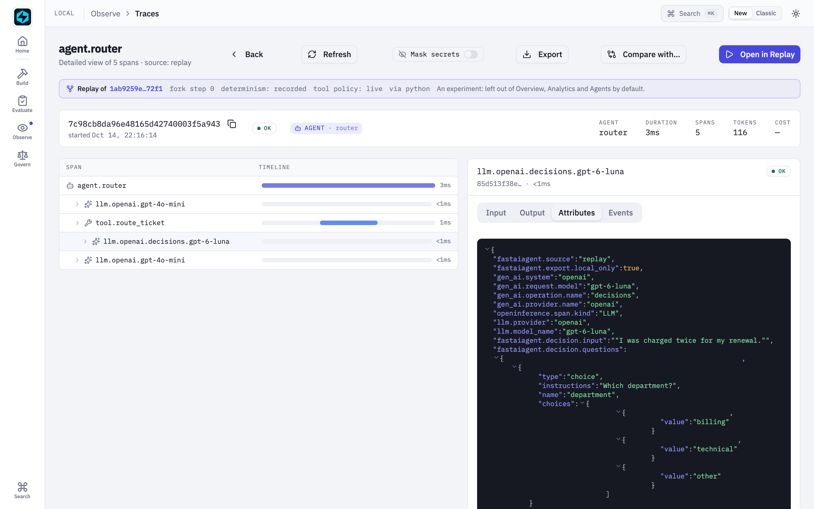

# Replay Fidelity Guarantees

This page documents what Agent Replay captures, what it can faithfully
reproduce, and where the known fidelity gaps are. Each guarantee is
backed by a test in
[`tests/test_replay_determinism.py`](https://github.com/fastaifoundry/fastaiagent-sdk/blob/main/tests/test_replay_determinism.py).

## Determinism modes

`ForkedReplay.with_determinism(mode)` controls how the LLM is invoked
during a rerun:

| Mode | LLM HTTP call | Output |
|---|---|---|
| `"live"` *(default)* | Yes — uses the captured temperature/seed. | Nondeterministic for non-zero temperature. Matches the original behavior. |
| `"recorded"` | **No** — replays the captured response. | Byte-identical to the original. Use for regression tests. |
| `"deterministic"` | Yes — but with `temperature=0` and `seed=42` forced. | Semantically stable across runs where the provider supports `seed`. |

```python
from fastaiagent.trace.replay import Replay

replay = Replay.load(trace_id)
forked = (
    replay
    .fork_at(step=0)
    .modify_prompt("Be more concise.")
    .with_determinism("recorded")  # ← skips the LLM call entirely
)
result = forked.rerun()
```

## What `"recorded"` mode captures

The recorded `LLMResponse` is reconstructed from these GenAI
semantic-convention attributes on the captured `llm.*` span:

* `gen_ai.response.content` — main text output
* `gen_ai.response.finish_reason` — `stop`, `length`, etc.
* `gen_ai.response.tool_calls` — tool invocations the original LLM
  requested (JSON-decoded into `ToolCall` instances)

These attributes are always captured into `local.db`, whatever
`FASTAIAGENT_TRACE_PAYLOADS` is set to — the flag governs export, not capture.
A trace that carries none of them, such as one pulled from the platform after
payloads were stripped on export, makes `recorded` mode raise `ReplayError`.

**A turn that only calls tools is replayed too (1.84.0).** OpenAI sends `content:
null` on such a turn, so its span has `gen_ai.response.tool_calls` and no
`gen_ai.response.content`. Before 1.84.0 those spans were skipped. A recorded
rerun of any tool-using agent jumped straight to the captured final answer, never
ran a tool, and still matched the original output. Now the tool-call turn is
served in order, so the rerun reaches the agent's tools. What it does with them
is the [tool policy](#tools-a-rerun-runs-only-what-you-supply): by default
(1.89.0) it blocks them.

### Decisions API calls (1.84.0)

Calls to [`LLMClient.adecide`](../llm/decisions.md) are recorded on their own
`llm.<provider>.decisions.<model>` spans (identified by `gen_ai.operation.name="decisions"`),
and they replay from their **own queue**. A decision is
never handed to a chat turn, or a chat turn to a decision. Under `recorded`, each
`adecide` gets the next captured result, tagged `replay.mode="recorded"`. A
decision the original run didn't make is a miss, handled by `on_miss`. That
covers more decisions than were captured, or a captured one that answered
different questions.



### Multi-turn replay (v1.14.1+)

For a multi-turn tool-loop trace with N captured `llm.*` spans,
`recorded` mode installs the **full ordered sequence** of responses
(sorted by `start_time`) and pops the front entry for each
`LLMClient.acomplete` call during rerun. So:

* Turn 1 of the rerun gets the trace's first captured response.
* Turn 2 gets the second, etc.
* If the rerun makes **more** LLM calls than the original captured
  (e.g. a tool override that triggers an extra reasoning turn), the
  queue drains and subsequent calls fall through to a **live**
  provider call — the agent doesn't deadlock.

Pre-v1.14.1 the same first response was returned for every LLM call
in the rerun, which made tool-loop replays nonsensical (every turn
parroted turn 1).

#### Controlling the drained-queue fall-through (v1.48.0+)

That live fall-through is billed and nondeterministic, and before
v1.48.0 it happened silently. It is now warned loudly, and you can
make it fatal — recommended whenever the rerun is a regression test:

```python
forked.with_determinism("recorded", on_miss="error")   # raises ReplayError
forked.with_determinism("recorded")                    # default: on_miss="live"
```

`on_miss="error"` raises before any provider call, so a recorded suite
can never quietly spend tokens or return drifted output.

#### Guardrail model calls have their own queue (1.89.0)

A model-backed guardrail (`llm_judge`, `content_safety`, `groundedness`,
`topic`) makes its own model call, and before 1.89.0 that call popped the same
queue as the agent:

- a judge present in the rerun but not the original **took the agent's
  turn**: an input judge was handed the recorded tool-call turn, read it as a
  failing verdict, and blocked the rerun;
- a judge present in the original but not the rerun **handed its verdict to
  the agent**, which answered `{"verdict": "PASS", …}`.

Now the recordings are split by role. A guardrail's call is served from the
original's guardrail recordings and the agent from its own turns. A judge in
the rerun with no recording is a miss under `on_miss`; a judge in the
original but not the rerun leaves its recording unused.

Recordings are told apart by span ancestry: a call under a `guardrail.*`
span is the guardrail's (the guardrail span wraps its check since 1.89.0). In
older traces the judge's span is a sibling, so a call counts as a guardrail's
when the trace has guardrail spans and the request has the SDK guardrail
shape (a system message, then a user message starting `<<DATA>>` or
`<<CONTEXT>>`). This needs tracing on during the rerun; with tracing off the
rerun falls back to one shared queue and logs a warning.

## Known fidelity gaps

These are documented limitations to set expectations. Each is tracked
in the top-3-recommendation as a deferred follow-up.

### Streaming chunks aren't recorded granularly

Streaming responses (`agent.astream(...)`) yield individual
`StreamEvent` chunks, but only the **final accumulated content**
lands in `gen_ai.response.content`. `recorded` mode reconstructs the
LLMResponse from that final text — streaming cadence is lost.

For most regression-test scenarios this is fine: the final answer is
what you're testing. If you need per-chunk fidelity, file an issue —
granular streaming capture is on the deferred-follow-up list.

### Tools: a rerun runs only what you supply

No determinism mode records tools: `recorded` skips the LLM call, not the
tool calls the recorded turns ask for. Before 1.89.0 a rerun ran each of
them for real. A function tool ran the implementation registered in the
process, and a REST or MCP tool called the endpoint recorded in the trace. A
rerun of a refund agent refunded again.

**Since 1.89.0 a rerun runs only the tools you supply or allow.** Every other
tool is **blocked**. The model gets an error result that names the tool and
how to allow it, and the rerun counts the call:

```python
rerun = forked.rerun()
rerun.tool_dispositions    # {"lookup_order": "blocked", "charge_card": "blocked"}
rerun.blocked_tool_calls   # {"charge_card": 1}: the answer does not show its effect
```

A rerun that blocked a call also logs a warning. To give the rerun its tools:

| Call | What the rerun runs | Disposition |
|---|---|---|
| `with_tool_override(name, fn_or_tool)` | your function or tool, in place of the original | `override` |
| `with_tool_stub(name, returns=...)` | a stub that returns `returns` | `stub` |
| `with_tool_policy("live", allow=[...])` | the implementation registered in this process, for every function tool (or only those named in `allow`, under any policy) | `live` |
| `with_tools([...])` | exactly the list you pass; nothing is rebuilt from the trace | `override` |

```python
forked = (
    Replay.load(trace_id)
    .fork_at(0)
    .with_determinism("recorded", on_miss="error")
    .with_tool_policy("block", allow=["lookup_order"])   # the read-only lookup runs
    .with_tool_stub("charge_card", returns="charged 0.00 (stub)")
)
```

Further rules:

* **`live` needs the function in this process.** In a fresh process a
  function tool has no implementation, so it gets disposition `no_function`
  and returns "No function attached to this tool".
* **REST and MCP tools run only when named in `allow`.** Their endpoint was
  rebuilt from the trace, so `with_tool_policy("live")` alone does not call it.
  A REST tool whose auth headers were redacted from the trace is never called:
  its header holds the placeholder `[redacted]`, not the credential. Pass the
  live tool with `with_tool_override`. A `RESTTool` rebuilt anywhere else
  refuses such a header too, before any request.
* **`with_tool_policy("error")`** blocks the same tools and raises
  `ReplayError` instead of answering. In `recorded` mode it raises before
  anything runs, when a recorded turn calls a tool the rerun was not given.
* **The default policy** can be set per process with
  `FASTAIAGENT_REPLAY_TOOL_POLICY` (`block`, `error` or `live`).
* **Overrides never touch the global registry.** A callable you pass is
  wrapped as `FunctionTool(..., register=False)`. If you pass the tool the
  registry already holds under that name, `with_tool_override` warns: you
  probably meant a stand-in. Build stand-ins with
  `FunctionTool(..., register=False)` or `@tool(..., register=False)`.
  Tools built during a rerun register into a private overlay, not the
  process-wide registry.

**`@idempotent` does not protect a rerun.** Its cache is keyed by execution
and lives in the checkpointer. A rerun is a new execution and has no
checkpointer, so an allowed `@idempotent` function runs its body again. Allow
a tool as `live` only when running it again is harmless.

#### Pauses and governance during a rerun

The rerun agent is rebuilt from the trace **without a checkpointer and without
its platform `agent_id`**. Two consequences:

* **A rerun cannot pause.** If a tool calls `interrupt()`, `arerun()` raises
  `ReplayError` naming what it paused on; override that tool with
  `with_tool_override(...)` to replay past it. (Before 1.78.0 the bare
  `InterruptSignal` escaped `arerun()`.)
* **A rerun is not governed by approval policies.** It has no `agent_id` and
  never registers to get one, so managed approval policies never gate it.
  Domain-wide plane guardrails still run on a connected rerun: they are
  enforced at the edge, like local rules. A real side-effecting tool runs in a
  rerun only when you supply or allow it (see above): an explicit, local choice.

#### Marking tools with `replay_class`

Declare each tool's replay-safety class once at definition time. It is
recorded on every tool span as `fastaiagent.tool.replay_class`. **The SDK's
rerun does not act on it:** it blocks every tool you did not supply or allow,
whatever its class. The local UI shows the class beside each tool when you
pick what a rerun may run. The control plane's central Replay engine reads it
to decide, per call, whether to re-execute or inject the recorded output:

| `replay_class` | Replay behavior |
|----------------|-----------------|
| `"read_only"` | May be **re-executed** (no side effects — a GET, a pure lookup). |
| `"idempotent"` | Recorded output is **injected** (re-running is safe but unnecessary). |
| `"side_effecting"` | Recorded output is **injected**; never re-executed. |

```python
from fastaiagent.tool import tool

@tool(name="search_kb", replay_class="read_only")
def search_kb(query: str) -> str:
    ...

@tool(name="create_ticket")           # unmarked → "side_effecting" (safe default)
def create_ticket(summary: str) -> str:
    ...
```

The default is `"side_effecting"`, and a value is **never auto-inferred** — a
`GET` `RESTTool` is not automatically `read_only`. See
[Tools → Replay safety](../tools/index.md#replay-safety-replay_class).

### Provider-specific determinism support

| Provider | `temperature=0` | Seed support |
|---|---|---|
| OpenAI / Azure OpenAI | ✅ | ✅ via `seed=` |
| Anthropic | ✅ | ✅ via `seed=` |
| Gemini (native wire) | ✅ | ✅ via `seed=` |
| Bedrock | ✅ | ❌ — Bedrock has no `seed` field |
| Ollama / vLLM / local | ✅ | ✅ via `seed=` |
| Provider presets (groq, openrouter, mistral, …) | ✅ | Varies — most pass through `seed=` |

`deterministic` mode degrades gracefully on Bedrock — it forces
`temperature=0` and skips the seed. Output is still much more
reproducible than `live` but not byte-identical across runs.

## Divergence detection

`forked.compare(result)` now computes the first divergence by walking
the original and rerun step lists in parallel. Span names and span
output attributes are compared step-for-step; the first mismatch wins.

This replaces the v1.13 behavior of hardcoding `diverged_at` to the
fork point — which was misleading because the actual divergence often
happens later than where the user asked to fork.

**Only the run's own turns are aligned (1.89.0).** That means the root span
and its direct children, minus `memory.*` spans. A rerun has no memory, so
before 1.89.0 the missing `memory.*` spans shifted every later index, and a
byte-identical recorded rerun of a memory agent "diverged" at step 1. The
indices still point into the full step lists:

| Field | What it holds |
|---|---|
| `diverged_at` / `new_diverged_at` | the first differing turn, as an index into `original_steps` / `new_steps` |
| `aligned` | `(original_index, new_index)` pairs; `None` where one run had fewer turns |
| `skipped_steps` / `new_skipped_steps` | steps left out of the alignment (memory, nested spans) |
| `tool_diffs` | aligned tool calls whose status or result differ, with the rerun's disposition (`blocked`, `stub`, `live`, …) |
| `tools_diverged_at` | the first of those, as an index into `original_steps` |

Tool differences are kept apart from `diverged_at`. A recorded rerun whose
tool was blocked still reports the model's turns as identical. The blocked
call shows up in `tool_diffs`.

`compare()` reads the rerun from the store it was written to: the `store=`
argument, then `with_trace_db`, then the default store.

```python
comp = forked.compare(rerun_result)
assert comp.compare_status == "ok"
if comp.diverged_at is None:
    print("rerun matched the original step-for-step")
else:
    print(f"diverged at step {comp.diverged_at}: "
          f"{comp.original_steps[comp.diverged_at].span_name}")
```

When the rerun trace can't be loaded (e.g., `Agent.arun` failed),
`compare_status` is set to `"rerun_failed"` and `diverged_at` stays
`None` — so UIs can distinguish "matched everything" from "couldn't
tell".

## A rerun is an experiment, not a production run (1.89.0)

Before 1.89.0 a rerun's trace looked like any other run of the agent. It was
exported to the platform as a production run, it counted in the local UI's
Analytics, Overview and Agents pages, and eval curation and memory learning
could pick it up. A rerun also pushed its agent definition to the platform,
which could overwrite the real agent's registration with the rebuilt copy.

Now every span a rerun writes carries `fastaiagent.source = "replay"`. The
rerun's root also carries where it came from:

| Root attribute | Value |
|---|---|
| `fastaiagent.replay.source_trace_id` | the trace it replays |
| `fastaiagent.replay.fork_step` | the step it forked at |
| `fastaiagent.replay.determinism` / `.on_miss` | the determinism mode |
| `fastaiagent.replay.tool_policy` / `.tool_overrides` | the tool policy, and the names of overridden tools |
| `fastaiagent.replay.modifications` | what was modified, as kinds only (`prompt`, `input`, …), never the new text |
| `fastaiagent.replay.surface` | `python`, `cli` or `ui` |

Each `tool.<name>` span of the rerun carries
`fastaiagent.replay.tool_disposition`.

What follows from that:

* **Not exported by default.** The rows are written already marked as sent,
  so no exporter ships them, including an older SDK sharing the same
  `local.db`. `rerun.exported` says which applied. Opt in per rerun with
  `forked.with_export()`, or for every experiment with
  `fa.connect(export_experiments=True)` or `FASTAIAGENT_EXPORT_EXPERIMENTS=1`.
  An exported rerun keeps its `fastaiagent.source` attribute.
* **Never registered.** A rerun does not push its agent definition, whether
  or not it is exported.
* **Left out of production views.** Analytics, Overview, Agents,
  `list_traces(exclude_sources=True)`, `fastaiagent eval curate` and
  `fastaiagent learn` exclude experiment traces unless you ask for them
  ([Tracing → provenance](../tracing/index.md#where-a-trace-came-from-provenance)).
* **A store of its own, if you want one.**
  `forked.with_trace_db("experiments.db")` writes the rerun there instead of
  the default store. `compare()` finds it there.

## Saving a rerun as a regression test

`rerun.save_as_test(...)` appends a JSONL line in the format
`evaluate()` reads natively:

```python
rerun.save_as_test(
    "regression_tests.jsonl",
    input="What is our refund policy?",
    expected_output=str(rerun.new_output),
    source_trace_id=original_trace_id,
)
```

For the full failure → fix → regression-test loop, see
[`examples/62_replay_to_regression.py`](https://github.com/fastaifoundry/fastaiagent-sdk/blob/main/examples/62_replay_to_regression.py).
