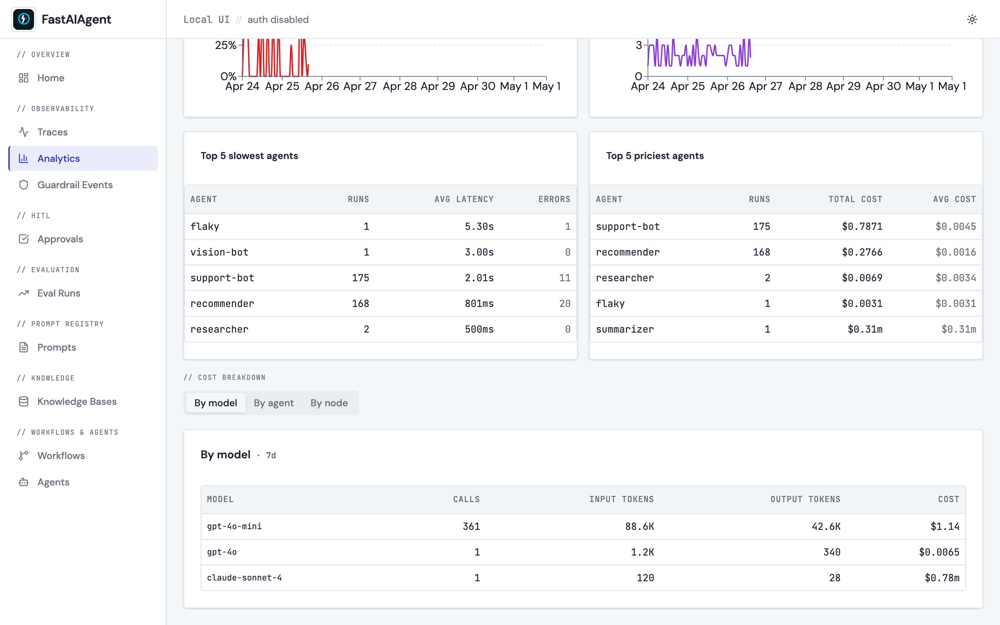
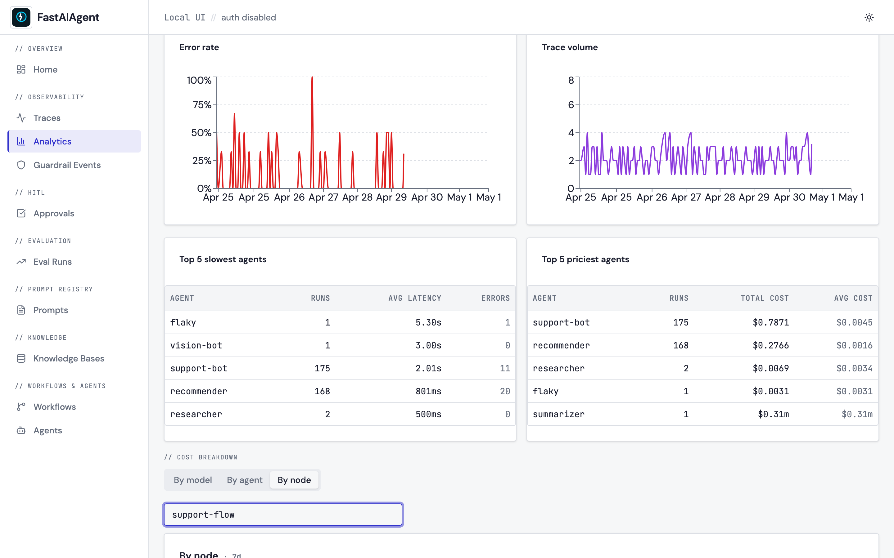

# Cost tracking dashboard

The Analytics page now ships a **// COST BREAKDOWN** section below the
existing latency / cost / error / volume charts. Three tabs slice the
spans table three ways: by LLM model, by agent, and by chain node.
Numbers come from the same `compute_cost_usd()` table that powers the
existing per-trace cost column — no double bookkeeping.



## Three breakdowns

| Tab | What it groups | Useful for |
|---|---|---|
| **By model** | Every LLM span, bucketed by `gen_ai.request.model` | "Which model is most of my spend on?" |
| **By agent** | Root agent spans (run count) plus their LLM children (tokens + cost) | "Which agent is most expensive per run?" |
| **By node** | LLM spans bucketed by `chain.node_id` for one named chain | "Which node in `support-flow` dominates the bill?" |

The **By node** tab requires a chain name — type it into the input
above the table:



## Window picker

The same `24h / 7d / 30d` window picker at the top of the Analytics page
controls the cost-breakdown lookback. The mapping is:

| Page choice | Endpoint param |
|---|---|
| 24h | `period=1d` |
| 7d  | `period=7d` |
| 30d | `period=30d` |

(`period=all` is also accepted by the endpoint — currently bounded to
90 days for safety.)

## Endpoint

```
GET /api/analytics/costs?group_by=model&period=7d
GET /api/analytics/costs?group_by=agent&period=7d
GET /api/analytics/costs?group_by=node&chain_name=support-flow&period=7d
```

Response shape (model mode):

```json
{
  "group_by": "model",
  "period": "7d",
  "rows": [
    {"model": "gpt-4o", "calls": 1240, "input_tokens": 2100000,
     "output_tokens": 340000, "cost_usd": 18.42}
  ]
}
```

For agent mode each row carries `runs`, `avg_tokens`, `avg_cost_usd`,
`total_cost_usd`. For node mode each row carries `executions`,
`avg_duration_ms`, `avg_cost_usd`, `percent_of_total`.

## How cost is computed

For every LLM span the endpoint:

1. Reads the cost the SDK reported on the span — `fastaiagent.cost.total_usd`,
   or the legacy `agent.cost_usd`. Since 1.67.0 `LLMClient` writes
   `fastaiagent.cost.total_usd` on every `llm.*` span it emits, which is the
   same attribute the LangChain, CrewAI and Pydantic-AI integrations have
   always set — so this path now hits for the SDK's own runs too, not only for
   foreign frameworks.
2. Falls back to `compute_cost_usd(model, input_tokens, output_tokens)`
   from [`fastaiagent/_internal/pricing.py`](https://github.com/fastaifoundry/fastaiagent-sdk/blob/main/fastaiagent/_internal/pricing.py)
   (re-exported as `fastaiagent.ui.pricing`) when the explicit cost isn't set —
   an older trace, or a model with no rate at the time of the run.
3. Drops to `0.0` only when both paths fail (unknown model + no
   reported cost).

Step 1 hitting where step 2 used to is why the figures should not move: the SDK
prices a call with the same table and the same token counts the endpoint would
have used. A model with **no** rate still reports nothing rather than `$0.00` —
the attribute is left absent on purpose, so the estimate can take over instead
of a fabricated zero being read as fact.

This matches the rule the workflows aggregator uses, so per-workflow
cost cards and the breakdown tables agree by construction.

### Where a cost belongs (1.89.0)

Cost lives on the `llm.*` spans, **under** the agent or workflow span, never on
it. Three pages priced the wrong span and showed `$0.00` (or "—") for every
run; since 1.89.0 they sum the calls beneath it:

| Page | What it sums |
|---|---|
| **Agents** | each priced call, credited to its **nearest** enclosing `agent.*` span. A worker's calls count for the worker; the lead that called it is not charged them a second time, so agents add up to the total |
| **Workflows** | every priced call under the chain / swarm / supervisor span |
| **Eval runs** | **Agent cost**: the calls in each case's agent trace. **Eval cost**: the judges' calls, in each case's `eval.score` trace. Kept apart, so a judge-heavy suite does not look like an expensive agent |

**Unknown is not zero.** When any call in a trace has tokens but no price (a
private fine-tune, an unpriced deployment), the eval run's cost is flagged
`*_cost_known: false` and the page shows it as partial; a run with nothing
traced shows "—", never `$0.00`.

**Tokens are counted once.** The root agent span also carries a roll-up,
`agent.tokens_used`. The Traces list and trace detail used to add it *and* each
call's tokens, so every agent trace showed twice its tokens. The per-call
numbers are used now; the roll-up only when no span carries any.

### Cached, written and long prompts (1.91.0)

A call is priced in parts. The prompt tokens the provider read from its prompt
cache (`usage["cached_tokens"]`) are priced at the cached rate, the ones written
to it (`cache_write_tokens`) at the write rate, and the rest at the input rate.
A prompt longer than the model's long-context threshold is priced at that tier
for the whole call: above 272k tokens on OpenAI, above 100k on Claude Haiku 5.5,
and above 200k on Gemini 3.1 Pro. Reasoning tokens are part of every provider's
completion count, so they are priced at the output rate.

| | What it was | Since 1.91.0 |
|---|---|---|
| OpenAI cache hit (automatic) | full input rate | the cached rate: 1/10 of input, 1/20 on GPT-6.1 Sol |
| GPT-5.6+ / GPT-6 cache write | full input rate | 1.25× input |
| Claude cache (with `LLMClient(cache=True)`) | not possible | reads 0.1× (0.05× Opus/Sonnet 5.5, 0.025× Fable/Mythos 5.1), writes 1.25× (2× for one hour) |

See [Reasoning and prompt caching](../llm/reasoning-and-caching.md).

## Updating prices

The built-in table is public list price from each provider's pricing page, keyed
by model-id prefix (longest prefix wins), in `fastaiagent/_internal/pricing.py`.
A row covers its model's dated and suffixed ids (`gpt-5` prices
`gpt-5-2025-08-07`), **never a later version**: before 1.91.0 the `gpt-5` row
priced `gpt-5.5` at a quarter of its price. A model the table does not know
is unpriced (shown as "—"), not priced at a neighbour's rate. Price changes a
provider has already announced are dated there too, and a call is priced at the
rate in force on the day it is made. `gemini-4-argon` doubles on 2026-12-01 and
`gemini-3.6-flash` / `gemini-3.8-flash` on 2027-01-01, with no SDK release
needed.

**Your own rates** — negotiated prices, or a model the table does not list (for
example `gemini-3.5-flash`, which Google serves but does not price on its page) —
go in the `pricing` block of `models.json` in the Local UI's data directory:

```json
{
  "pricing": {
    "gemini-3.5-flash": {"input_per_1m": 0.30, "output_per_1m": 2.50},
    "my-finetune": {
      "input_per_1m": 1.00,
      "output_per_1m": 4.00,
      "cached_input_per_1m": 0.10,
      "cache_write_per_1m": 1.25
    }
  }
}
```

or in code with `fastaiagent.ui.pricing.set_rate_overrides({"gemini-3.5-flash":
(0.30, 2.50)})`. The tuple can also carry the cached and write rates:
`(input, output, cached, write)`. Without them, cached and written tokens are
priced at the input rate. An override wins over a built-in rate of the same
prefix. It is not dated: it is the rate. It is a plain prefix, so `"gpt-5"` also
covers `gpt-5.5`. Every caller uses it: `AgentResult.cost`, the `cost_limit`
guardrail, the trace export and these dashboards.

A run's cost is written onto its `llm.*` spans when it runs (step 1 above), so a
new rate prices calls made **after** the change; older spans keep the cost they
were recorded with. Only a span with no recorded cost is re-estimated from its
tokens on read.

## Try it from the examples

Any example that runs an LLM through `fastaiagent` populates the cost
breakdowns. For a quick spread across multiple models / agents / chain
nodes:

- [`examples/35_local_ui.py`](https://github.com/fastaifoundry/fastaiagent-sdk/blob/main/examples/35_local_ui.py)
  — produces traces, evals, and guardrail events the cost dashboard
  aggregates.
- [`examples/39_workflows_demo.py`](https://github.com/fastaifoundry/fastaiagent-sdk/blob/main/examples/39_workflows_demo.py)
  — runs Chain + Swarm + Supervisor in one script, so the **By node**
  tab has multiple `chain_name` values to slice.

After running either, open Analytics in the Local UI and scroll to the
**// COST BREAKDOWN** section.

## Where the screenshots come from

Both screenshots are captured by `scripts/capture-sprint1-screenshots.sh`
against the seed in `scripts/seed_ui_sprint1.py`, which lays down five
LLM spans across three models (gpt-4o, gpt-4o-mini, claude-sonnet-4)
under three agent names and three chain nodes inside `support-flow`.
