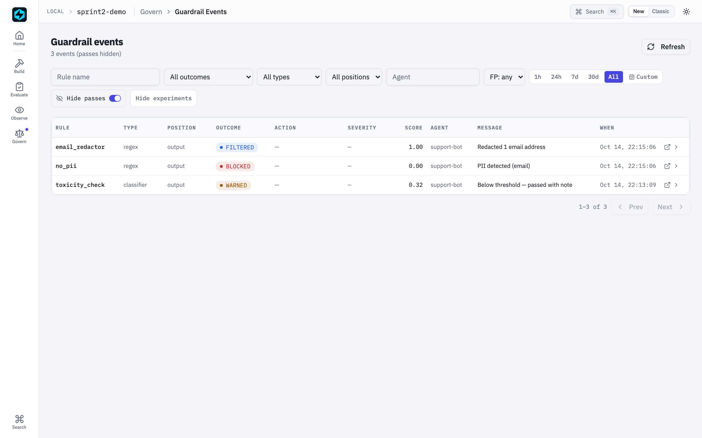
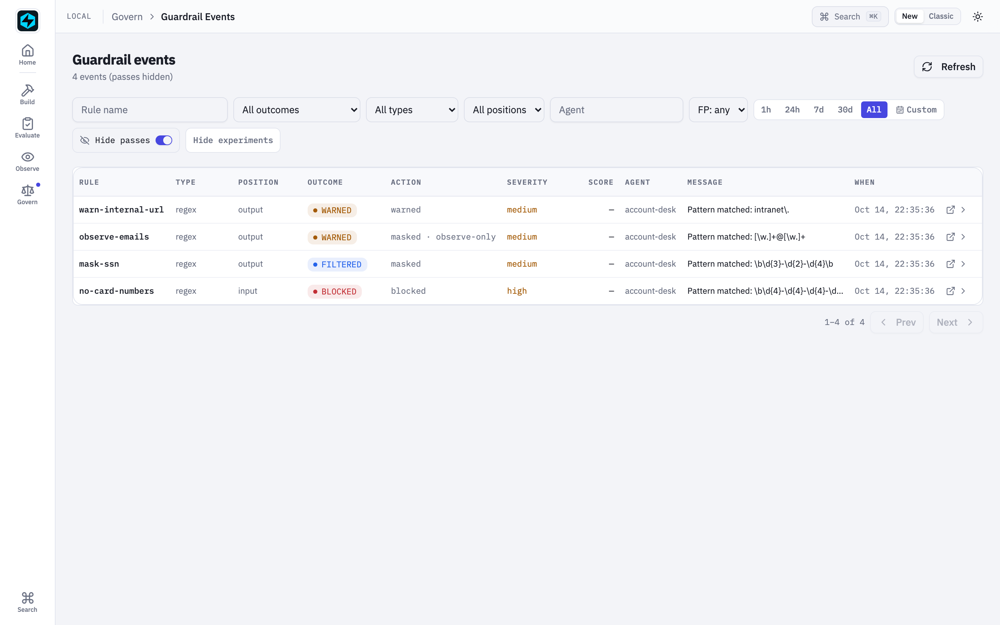
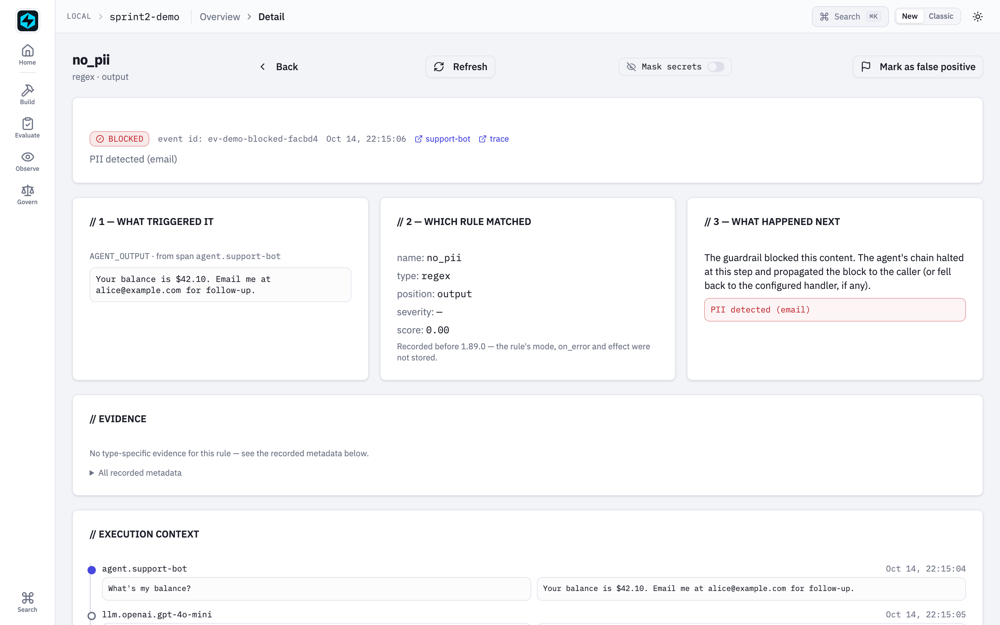
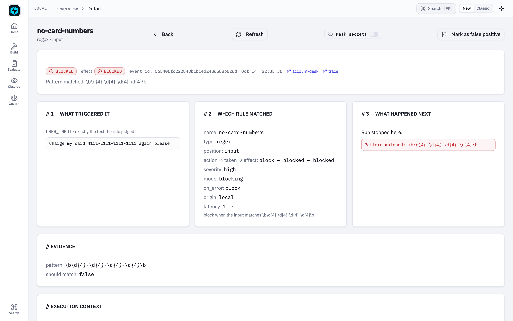
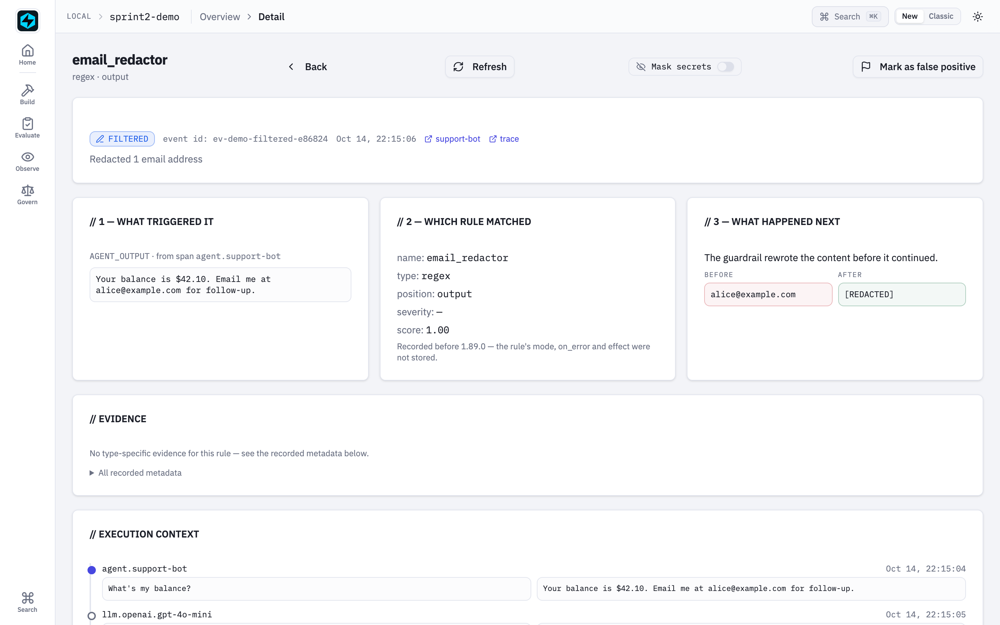
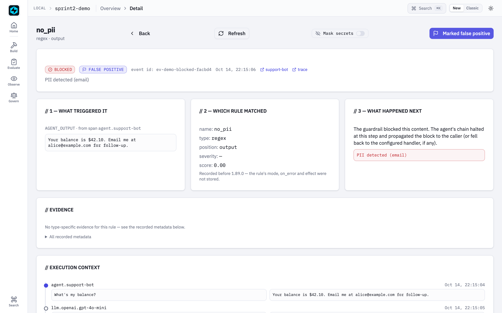

# Guardrail Event Detail

Every guardrail check produces a row in the `guardrail_events` table of
`local.db`, passes included.
The list page at [/guardrails](https://github.com/fastaifoundry/fastaiagent-sdk/blob/main/docs/ui/index.md)
has always shown the summary; the **detail page** at
`/guardrail-events/{event_id}` shows the full story behind each event:
*what the rule judged*, *which rule ran and how it was configured*, *what it
did to the run*, and the execution context it ran inside.

## When rows are written (1.89.0)

**Whenever tracing is on** (`FASTAIAGENT_TRACE_ENABLED`, default on), in the
process that runs the agent. The record is local capture, like spans, and it
never leaves the machine.

| Caller | Writes a row |
|---|---|
| An `Agent`, `Chain`, `Supervisor` or `Swarm` run | for every check, once |
| The LangChain, CrewAI and PydanticAI proxies | for every check, once |
| A bare `Guardrail.execute()` / `aexecute()` | only inside a recording span, so a check called from a web handler never creates `local.db` |
| `log_guardrail_event(...)` called directly | whenever tracing is on |

Before 1.89.0 rows were written only when `FASTAIAGENT_UI_ENABLED` was set in
the **agent's** process, so the page was empty by default. That variable no
longer affects anything. `FASTAIAGENT_TRACE_ENABLED=0` writes no rows (it used
to write them with `UI_ENABLED=1`, `before` payloads included).

The UI must read the same `local.db` the agent wrote
(`FASTAIAGENT_LOCAL_DB`, or `fastaiagent ui --db`). An empty list says so, and
counts the guardrail spans of traces recorded before 1.89.0, which have no rows.

The list's filters, time range, "hide passes", "hide experiments" and page are
kept in the URL (*1.89.0*), so a filtered view survives a refresh and can be
shared; a quick range such as the last 24 hours is stored as `range=24h` and
recomputed when the link is opened.





## Three panels

When you click a row on the Guardrails list (or follow the badge from
the Trace Detail page's *Scores* card), you land on a three-panel layout:



| Panel | Contents |
|---|---|
| **1 — What it judged** | Exactly the text the rule saw (1.89.0): the input after earlier input rewrites, the reply at that attempt, the `{"tool", "arguments"}` envelope of a tool call, or the raw tool result. When an earlier rule in the same pass rewrote it, the panel says so. Rows from before 1.89.0 fall back to the parent span's text, or say it was not recorded. |
| **2 — Which rule ran** | Name, type, position, and how it was configured: action → what it did (`action_taken`) → its effect on the run, with `*` when they differ; severity, the floor badge, blocking or observe-only, `on_error`, origin (local or plane), latency and attempt. Then the evidence for its type: content-safety scores against thresholds, groundedness score and unsupported claims, schema violations, the judge's prompt and reply, the regex pattern, PII and secret kinds and counts (never the values), and all recorded metadata as a fallback. |
| **3 — What happened to the run** | Read from the effect: the run stopped here (and why, when a rewrite or re-ask was refused); the payload was rewritten (a **before / after** diff); the model was re-asked (see the next attempt); a `warn` recorded and continued; an observe-only rule enforced nothing (its diff labelled *would have produced, not applied*); or the check could not run, and `on_error` let the content through unchecked or blocked it. |

A **Mask secrets** switch applies the installed read-mode redaction policy to the
judged text and the diff, as on Trace Detail.

!!! note "The `errored` outcome"
    A model-judged guardrail whose LLM call fails is logged with an `errored`
    outcome (rather than silently passing), so you can see how often a check is
    degrading instead of guarding. Its effect says what happened next:
    `unchecked` (on_error=allow let the payload through), `blocked` (fail
    closed), or `observed` (an observe-only rule enforces nothing either way).

## What a row says: outcome and effect (1.89.0)

`action_taken` is the *resolved action*, the same value the guardrail span and
the plane carry. It ignores `blocking`: an observe-only `mask` reports `masked`
though nothing was applied. Each row now also records its **effect**, what the
check did to the run:

| Check | Effect | Outcome |
|---|---|---|
| clean pass | `none` | `passed` |
| could not run, `on_error=allow`, blocking | `unchecked` | `errored` |
| could not run, `on_error=block`, blocking | `blocked` | `errored` |
| could not run, observe-only | `observed` | `errored` |
| failed, `block` (or a `mask` with nothing to mask) | `blocked` | `blocked` |
| failed, `warn` | `warned` | `warned` |
| failed, `mask` / `override`, rewrite applied | `rewritten` | `filtered` |
| failed, `reask`, the model was asked again | `reasked` | `reasked` |
| failed, `reask` at a position with no model turn, or out of retries | `blocked` | `blocked` |
| a rewrite or re-ask the caller could not apply (a streamed reply, multimodal input, a tool call that is no longer an arguments object, a tool result with image/PDF parts) | `blocked`, with `final_reason` | `blocked` |
| failed, observe-only | `observed` | `warned` |
| a framework proxy's `mask` / `override` / `reask` | `blocked`, with `final_reason` | `blocked` |

What changed from 1.88.0: a re-ask was recorded as `blocked`, an observe-only
mask as `filtered`, and a refused rewrite as `filtered` with no record of the
block. A refused row is written when the check runs and updated in place when
the caller refuses, so a crash keeps the evidence. The guardrail span is
unchanged: same attributes, same status (ERROR for any verdict that is not a
pass). The span tree colours a guardrail by what it did, not by that status.

Rows from before 1.89.0 have no effect and keep their old meaning.





Below the three panels, an **execution context** section shows up to 8
spans from the same trace as a vertical timeline (with the triggering
span highlighted) plus a list of *other guardrails that ran on the same
content* (the same position pass). That sibling list is critical for
debugging — it tells you whether a `blocked` outcome was unanimous across
rules or a single opinionated rule overruling the rest.

## The list

The list pages through every row (Prev / Next) and filters by rule, outcome,
agent, type, position, false-positive flag and a time range. Two switches:

- **Hide passes**, on by default: passes are recorded, but they would bury
  everything else.
- **Hide experiments**: leaves out checks from replay reruns and Playground
  calls.

The Action column reads `masked · observe-only` for a rule that enforced
nothing, and `blocked (was masked) *` for a rewrite the run refused, with the
reason on hover.

## Mark as false positive

Top-right of the detail page is a **Flag · Mark as false positive**
button. Click it and the event row's `false_positive` column flips to
`1` plus a `false_positive_at` timestamp. Refresh the page — the flag
persists. Toggle again to clear: since 1.89.0 that also clears
`false_positive_at` (it used to keep the time it was cleared).



The flag surfaces in two places after toggling:
- An "FP" badge on the corresponding row of the Guardrails list.
- A new `FP: yes / FP: no / FP: any` filter at the top of the list, so
  you can quickly hide noise once you've curated it.

This flag is intentionally a UI annotation only — agent runtime is
unaware of it. The event still ran, the rule still fired, the trace is
still immutable. What changes is just *your view* of the event.

> **Sprint 3 follow-up.** "Save as guardrail eval case" on the same
> button is deferred — for now, the flag is the bridge.

## Endpoints

```
GET   /api/guardrail-events
        ?rule=...&outcome=...&agent=...&type=...
        &position=...&false_positive=true|false
        &hide_passes=true|false&exclude_experiments=true|false
        &since=...&until=...&page=...&page_size=...
GET   /api/guardrail-events/{event_id}?redact=true|false
PATCH /api/guardrail-events/{event_id}/false-positive
        body: {"false_positive": true|false, "note": "optional"}
```

1.89.0 additions, all additive:

- Each row carries `effect`, `final_reason`, `latency_ms`, `attempt`,
  `batch_id`, `guardrail_span_id`, `judged_ref` and `rule` (the rule as it ran,
  with a judge's `config.llm` reduced to provider and model), plus `blocking`,
  `on_error` and `origin` read from it.
- `outcome` can be `reasked`.
- The list returns `legacy_guardrail_spans` when it is empty.
- The detail adds `judged: {text, recorded}`; `trigger` is kept for older
  clients.
- Trace spans (`/api/traces/{id}` and `/api/traces/{id}/spans`) carry
  `guardrail: {event_id, outcome, effect, blocking, final_reason}` on each
  guardrail span.

The list endpoint gained four new filters in Sprint 2: `type` and
`position` (existing fields, now surfaced through the API and a pair of
list-page selects), plus `false_positive` to slice annotated rows.

`type` accepts every implementation type, including the model-backed ones
(`content_safety` and `groundedness`, added in 1.57.0; `topic`, added in 1.58.0),
and `outcome` accepts `filtered` — a rule that rewrote the payload and let the run
continue. Every row also carries `action`, `action_taken`, `severity` and `floor`.

The detail endpoint joins the event row with:
- the text it judged (`guardrail_payloads`)
- the triggering span (read by `span_id`)
- up to 8 surrounding spans on the same trace
- every sibling event of the same pass (`batch_id`; for rows from before 1.89.0,
  the same `(trace_id, span_id)` pair)

Every endpoint is project-scoped. Cross-project event ids return 404 so
multi-project Postgres deployments stay isolated.

## Schema

Sprint 2 bumps the local schema to **v5** with two new columns on
`guardrail_events`:

```sql
ALTER TABLE guardrail_events ADD COLUMN false_positive INTEGER DEFAULT 0;
ALTER TABLE guardrail_events ADD COLUMN false_positive_at TEXT;
```

Migrations are idempotent — running an existing v4 DB through `init_local_db()`
adds the columns without backfill (default `0` is correct for historical
events).

### v18 — what the failure cost (1.57.0)

`outcome` alone can no longer describe what happened. A failure may now warn,
mask, override or re-ask instead of blocking, and two rules with the same outcome
can have arrived there very differently — a `mask` that found nothing to redact
blocks, and so does an errored `warn`:

```sql
ALTER TABLE guardrail_events ADD COLUMN action       TEXT;
ALTER TABLE guardrail_events ADD COLUMN action_taken TEXT;
ALTER TABLE guardrail_events ADD COLUMN severity     TEXT;
ALTER TABLE guardrail_events ADD COLUMN floor        INTEGER DEFAULT 0;
```

`action` is what the rule was configured to cost; `action_taken` is what it
actually did. The pair is what makes an over-blocking rule visible. `severity`
and `floor` change no behaviour — see
[Actions, severity & floor](../guardrails/actions.md).

All four are `NULL` on events recorded before 1.57.0, and the migration is
additive: an older SDK opening a v18 file runs no migration and reads by name.

The events table shows `Action` and `Severity` next to the outcome, with a
`FLOOR` badge on the organisation baseline. An action that **could not be
carried out** is flagged with `*`: an errored check always blocks whatever its
action said, and a `mask` that finds no span to redact degrades to a block. Both
are safety behaviours, not faults — but a rule configured to `mask` that shows
`blocked` is worth seeing at a glance.

### v25 — what the check did to the run (1.89.0)

```sql
ALTER TABLE guardrail_events ADD COLUMN effect            TEXT;
ALTER TABLE guardrail_events ADD COLUMN rule              TEXT;    -- JSON snapshot
ALTER TABLE guardrail_events ADD COLUMN latency_ms        INTEGER;
ALTER TABLE guardrail_events ADD COLUMN judged_ref        TEXT;    -- guardrail_payloads.payload_id
ALTER TABLE guardrail_events ADD COLUMN guardrail_span_id TEXT;
ALTER TABLE guardrail_events ADD COLUMN batch_id          TEXT;
ALTER TABLE guardrail_events ADD COLUMN attempt           INTEGER;
ALTER TABLE guardrail_events ADD COLUMN final_reason      TEXT;
CREATE TABLE guardrail_payloads (payload_id TEXT PRIMARY KEY, text TEXT NOT NULL, created_at TEXT);
```

`guardrail_payloads` is content-addressed: every rule that judged the same text
shares one row (the SHA-256 of the text after the capture-mode redaction policy,
if one is installed). `FASTAIAGENT_TRACE_PAYLOADS` does not apply, because
nothing here is exported. `fastaiagent traces purge` and deleting a trace in the
UI remove a trace's rows and any payload no remaining row refers to; before
1.89.0 `purge --older-than-days` removed no guardrail rows at all. The new
columns are nullable, so an older SDK still writes to a v25 database, and its
rows read as legacy. Nothing is backfilled.

!!! note "`filtered` is now produced, not just rendered"
    The detail page has always known the `filtered` outcome and its before/after
    diff. Until the action spectrum shipped, no runtime code could write one —
    every failure was a block. A `mask` or `override` rule now writes
    `outcome="filtered"` with `metadata.before` / `metadata.after` filled in for
    you.

## Trace integration

On the [Trace Detail page](index.md#scores-on-a-trace), the existing
*Scores* card now wraps each guardrail row in a link to its detail page.
A click takes you straight from a span tree to the rule that fired on
it — and back — without a search round-trip.

## Example

[examples/51_guardrail_events.py](https://github.com/fastaifoundry/fastaiagent-sdk/blob/main/examples/51_guardrail_events.py)
**executes four real guardrails** inside two real traces — `blocked`
(`no_pii()` finds an email in the output), `filtered` (a `regex` rule with
`action="mask"`), `warned` (`action="warn"`), and a `mask` the runtime could
not carry out, which degrades to a block and earns the `*` marker — then prints
the URL of each detail page.

No agent runs and no API key is needed: every rule is a `regex` or `code` check,
and the rows come from the runtime's own writer (`ui.events.log_guardrail_event`,
reached through `Guardrail.execute` inside a span, which is when a bare call
records). Before 1.68.0 the example INSERTed rows
directly with a pre-v18 column list, so `action`, `action_taken`, `severity` and
`floor` were always NULL — the `*` marker documented above could never appear on
the very row the example exists to show.

```bash
python examples/51_guardrail_events.py
fastaiagent ui --no-auth
# http://127.0.0.1:7842/guardrails
```
