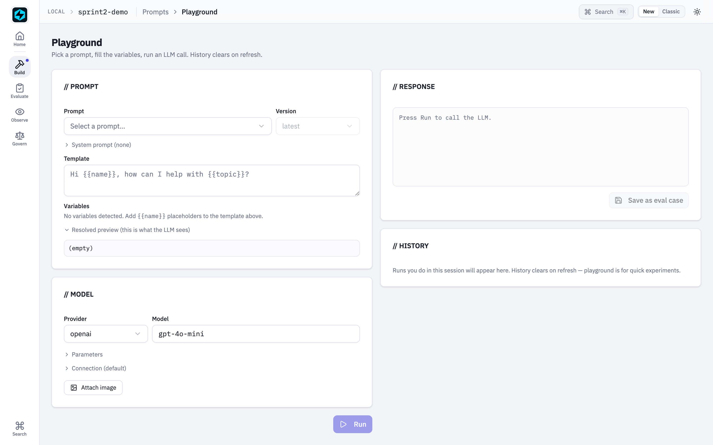
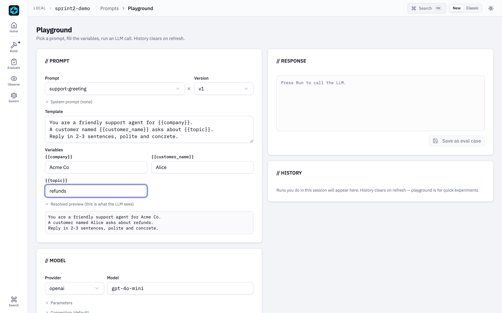
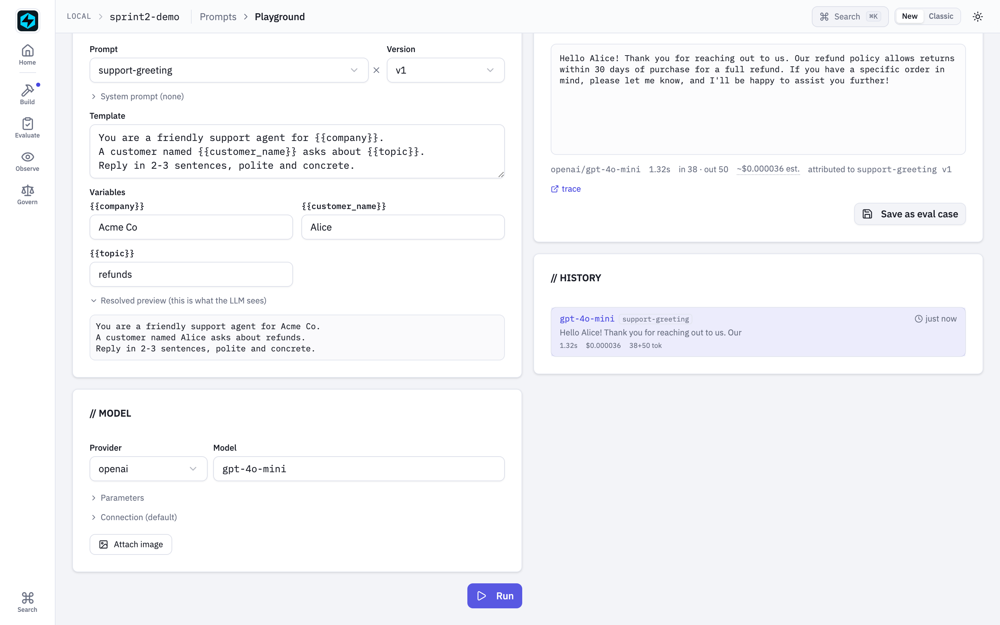
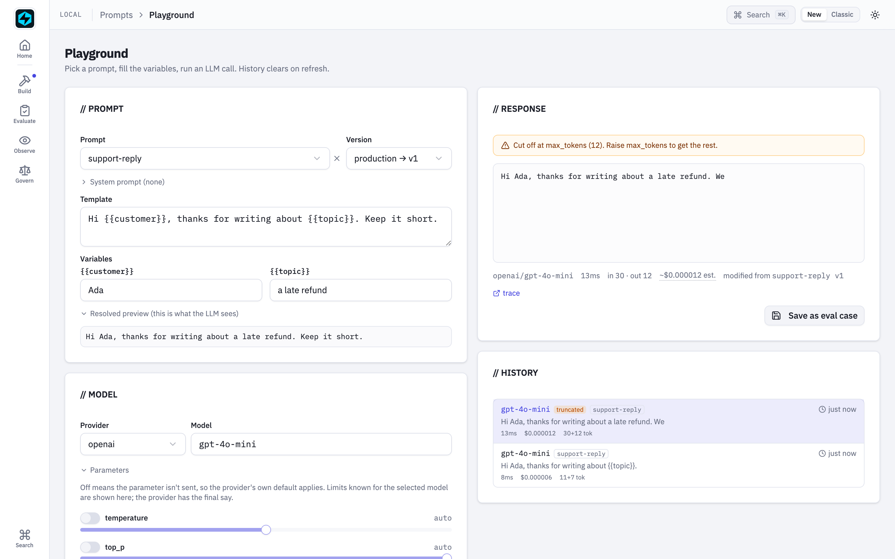
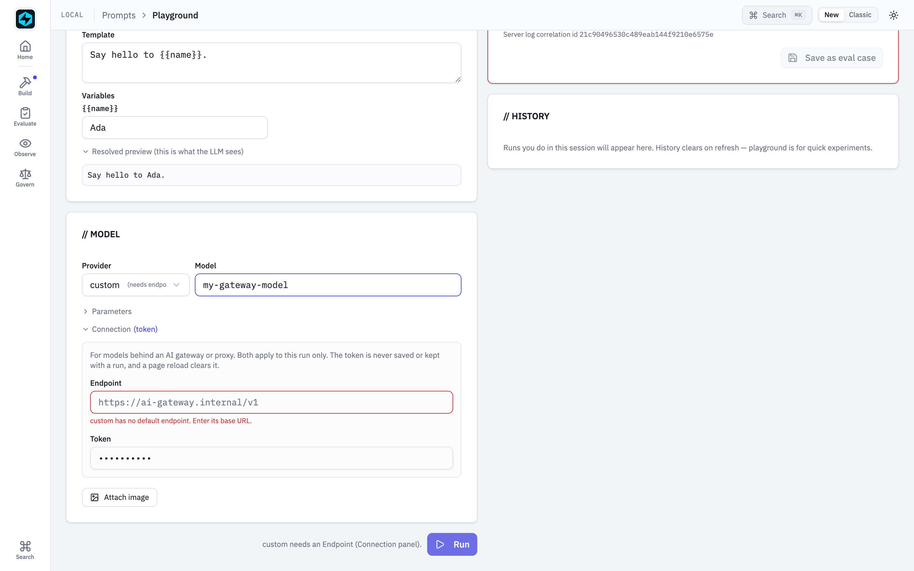
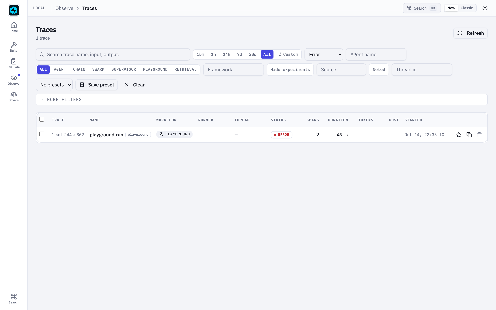
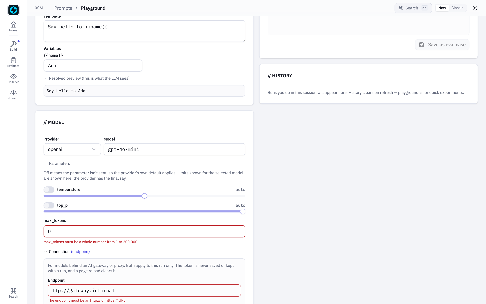

# Prompt Playground

The Playground is the iteration loop for prompts: pick a prompt from the
registry, fill in variables, choose a model, click Run, watch the response
stream back. Same SDK code path as production runs — same providers, same
cost tracking, same trace pipeline — minus writing a script.

Find it in the sidebar under `// PROMPT REGISTRY → Playground`, or jump
directly from any prompt detail page via the **Test in Playground** button.

!!! note "It runs a prompt, not your agent"
    A Playground run is one direct model call: the prompt you see, the model
    you pick, nothing else. Your agent's tools, knowledge bases, guardrails,
    memory and system prompt are not involved. To exercise the real agent from
    the UI, start it with `fastaiagent ui --agent app.py:my_agent` and use
    **Run eval** on a dataset, or resume it from **Approvals**; from code, use
    Replay or simulations.



## What it does

Two-panel layout. Left: configuration. Right: response.



**Configuration** (left)

- **Prompt + version**: dropdowns over your registered prompts. Picking one
  loads its template into the editor below. The version list shows every
  real version plus its aliases (`production`, `staging`, …), and a link
  with `?alias=production` opens the version the alias points at.

    A run from a registry prompt is **attributed** to it (*since 1.89.0*):
    when the template is unchanged, `{{@fragment}}` references are resolved
    the way an agent resolves them, the LLM span carries
    `fastaiagent.prompt.name` / `fastaiagent.prompt.version`, and the run
    shows up in that version's lineage. Edit the template and the run is
    marked *modified from greeter v3* instead: it is not credited to a
    version it did not use.
- **System prompt**: optional collapsible textarea. When set, sent as a
  system message; when empty, the resolved template is sent on its own.
- **Template**: editable textarea with `{{variable}}` placeholders. Edit it
  in place for one-off experiments — saving a new version still happens
  through the Prompt Editor.
- **Variables**: one input field auto-generated per `{{name}}` detected in
  the template. Updates re-render live. A variable left empty is sent as an
  empty string, so Run warns first and names them, with **Run anyway**; the
  response lists `unfilled_variables` too (*since 1.89.0*). Nothing is
  blocked: an empty variable is sometimes the test.
- **Resolved preview**: collapsible read-only block showing the exact final
  prompt the LLM will see.
- **Provider + model**: populated from the `/api/playground/models`
  endpoint. A provider with no API key in the server's environment is
  marked *(no key)*; picking it opens the Connection panel, and **Run**
  waits for a token there (*since 1.89.0*; it used to be a disabled option,
  so a gateway token could never be used with it). The provider list covers
  every built-in (`openai`, `anthropic`, `ollama`) plus every preset
  registered with `fastaiagent.llm.providers.register_provider` (12 ship
  in the box — Gemini, Groq, OpenRouter, DeepSeek, Together, Fireworks,
  Perplexity, Mistral, LM Studio, vLLM, SambaNova, Cerebras). See
  [LLM providers](../llm/providers.md) for the full table.

    The **model** field is a combobox, not a fixed list: pick a suggestion
    or type any model id the provider accepts. Suggestions are only
    suggestions — `LLMClient` takes whatever the upstream API knows, so a
    model released after your SDK version is always reachable. To change
    the suggestions themselves, see
    [Customising the model list](#customising-the-model-list).

- **Parameters**: temperature, top_p, max_tokens — mapped directly onto
  `LLMClient` config.

    temperature and top_p are **off by default** and read `auto` until you
    switch them on, which means they are not sent at all and the provider
    applies its own default.

    Providers refuse some sampling settings per model, and the controls
    follow those rules as you type the model id (*since 1.89.0*). Measured
    against the live APIs on 2026-10-14:

    | Models | temperature | top_p |
    |---|---|---|
    | `claude-opus-4-7`, `claude-opus-4-8`, the Claude 5 family | default (1) only | not accepted |
    | Other Claude models | any | any, but **not both** |
    | `gpt-5`, `gpt-5-mini`, `gpt-5-nano`, `o4-mini` | default (1) only | default (1) only |
    | `o1`, `o3` | default (1) only | not accepted |
    | `gpt-5.1`, `gpt-5.2`, `gpt-4o`, `gpt-4.1`, everything else | any | any |

    Bedrock and router ids (`us.anthropic.…`, `anthropic/…`) resolve to the
    vendor's model. In the panel, a parameter the model does not accept is
    switched off and not sent; one it accepts only at its default can be
    sent only at that value; and for a "not both" model, switching one on
    switches the other off (if both are already on, a warning shows and both
    are still sent). The table only **hints**: the server forwards what you
    set and the provider stays the authority, because these rules change on
    the provider's schedule. When a provider refuses a setting, the error
    names the rule (see [When a call fails](#when-a-call-fails)).
    `GET /api/playground/models` returns the table as `sampling_rules`.
- **Attach image**: optional file picker (JPEG/PNG/GIF/WebP). The image is
  sent as a multimodal content part alongside the text — choose a vision
  model in the model selector first.



**Response** (right)

- **Streamed response**: tokens appear as they arrive via SSE, fed by
  `LLMClient.astream()`. The Run button becomes a Stop button while
  streaming — clicking it closes the SSE reader and keeps whatever has
  already arrived.
- **Metadata bar**: provider/model · latency · input/output tokens ·
  estimated cost · trace link.

    A reply cut off by `max_tokens` says so (*since 1.89.0*): a banner reads
    *Cut off at max_tokens (N)* and the history row is marked. Before, a
    streamed reply recorded no finish reason, so a truncated answer looked
    complete. The response carries `finish_reason` (as the provider sent it:
    `length` from OpenAI, `max_tokens` from Anthropic) and `truncated`, and
    the LLM span records `gen_ai.response.finish_reason` on streamed calls
    too.

    

    Cost is shown as `~$x est.` because it is computed from **public list
    prices** (`compute_cost_usd()`). It cannot know about negotiated or
    committed-use discounts, Amazon Bedrock / Google Vertex partner rates,
    the Batch API's 50% reduction, or prompt-cache multipliers (cache reads
    bill at roughly 0.1x, writes at 1.25–2x, and the token counts here don't
    separate cached from uncached input). Treat it as an order-of-magnitude
    sanity check. If your organisation has its own rates, set them once —
    see [Customising the model list](#customising-the-model-list) — and
    every cost figure in the UI uses them, not just the Playground's.
- **History**: in-memory list of runs from this session. Click a row to
  restore the whole run as it was sent: template, variables, system prompt,
  provider, model, parameters, endpoint, registry prompt and version, the
  image (up to 5 MB; a larger one asks you to attach it again) and the
  response. The token is never kept. (Before 1.89.0 a row restored only the
  template, variables and response, so the next Run used whatever model and
  parameters were on screen.) Cleared on refresh.
- **Save as eval case**: appends a JSONL line to
  `./.fastaiagent/datasets/{name}.jsonl` so the case is immediately
  loadable via `Dataset.from_jsonl()` for guardrail / scorer evals. It
  appends, so repeated saves build a dataset up; the case also appears
  straight away in the Datasets page.

    It saves **the run you are looking at** (*since 1.89.0*): the input that
    produced the output, not whatever the form holds now (editing the
    prompt after a run used to pair the old output with the new input). An
    attached image is saved next to the dataset and the case input becomes
    text plus image, so it replays as the same multimodal request. The
    case's `metadata` keeps the sampling parameters (`temperature`, `top_p`,
    `max_tokens` only), the registry prompt `{slug, version}` (only when the
    template was sent unchanged), the trace id and the system prompt. The
    dialog shows the input as sent and warns when the form has changed since
    that run. A run you stopped has no complete output, so it cannot be
    saved.

    !!! warning "**Run eval** on that dataset needs a registered agent"
        With no agent selected, `run-eval` scores each input against an
        *identity function* — it echoes the input back, so a case passes only
        where `expected_output` equals `input`. On a Playground-saved case that
        is never true, and you'll see 0%. That is a dataset sanity check, not a
        model evaluation, and the UI labels the result accordingly.

        Start the UI with `fastaiagent ui --agent app.py:my_agent` (or drive the
        app yourself with `build_app(runners=[...])`), then pass `agent_name` —
        the result will report `mode: "agent"`. You can also run the eval
        framework directly against the JSONL.

## Tracing

Every Run emits a `playground.run` span tagged with
`fastaiagent.source = "playground"`, with the LLM call as a child span.
Since 1.89.0 every span of the run carries the tag, not only the root.
Open `/traces/{trace_id}` from the metadata bar to see the full
request/response, token usage, and provider call.

The root reads like any other run's root (*since 1.89.0*; it carried
nothing but the tag):

| Attribute | Value |
|---|---|
| `fastaiagent.runner.type` | `playground`, so the Traces list badges it **PLAYGROUND** |
| `fastaiagent.playground.input` / `.output` | the rendered prompt and the reply, shown as the trace's input and output |
| `fastaiagent.playground.truncated` | `true` when `max_tokens` cut the reply off |
| `fastaiagent.playground.unfilled_variables` | comma-separated names left empty |
| `fastaiagent.playground.prompt.base` / `.modified` | `greeter@v3` and `true` when an edited registry prompt was run |
| `fastaiagent.llm.provider` / `fastaiagent.llm.model` | what was called |

Input and output are payload attributes: they are in `SENSITIVE_ATTR_KEYS`,
so they are withheld on export under `FASTAIAGENT_TRACE_PAYLOADS=0` (and a
Playground trace is not exported at all unless experiments are, see below).
A failed run's root keeps only the opaque message and the failure `kind`;
the provider's own text goes to the response and the scrubbed server log,
never into the root span.

Replay rebuilds an agent from the trace's root agent span, and a Playground
trace has none, so **Open in Replay** is not offered on it.

That tag is surfaced on every row of the Traces list as `source`, and
`GET /api/traces?source=playground` filters to just Playground runs, so a
Playground run is distinguishable from production traffic rather than sitting
anonymously in the same list. `source` is free text: anything stamped on a
span as `fastaiagent.source` shows up and filters the same way.

A Playground run is an experiment, not production traffic (1.89.0):

- **Not exported.** Its spans never leave the machine, even when the process
  is connected to the platform, unless you opt in with
  `connect(export_experiments=True)` or `FASTAIAGENT_EXPORT_EXPERIMENTS=1`.
- **Not counted.** Analytics, Overview and Agents leave it out and report
  experiment spend separately; **Include experiments** counts it in.

If the trace goes to a different store than the one the UI reads (an app
that embeds `build_app(db_path=...)` with its tracer pointed elsewhere), the
response says `trace_in_ui_db: false` and the metadata bar does not offer a
trace link that would 404. `fastaiagent ui --db PATH` never splits them: it
points the whole process at `PATH`.

## Endpoints

```
GET  /api/playground/models
POST /api/playground/run
POST /api/playground/stream    (text/event-stream)
POST /api/playground/save-as-eval
```

`/run` is the non-streaming fallback used by tests and any client that
can't read SSE. `/stream` is what the UI uses by default.

Both take an optional `prompt_ref: {"slug", "version" | "alias"}` naming the
registry prompt the template came from. Besides the reply, `/run` returns
(and `/stream`'s `done` event carries in `metadata`):

```json
{
  "finish_reason": "length",
  "truncated": true,
  "max_tokens": 64,
  "unfilled_variables": ["city"],
  "prompt": {"slug": "greeter", "version": 3, "attributed": true, "modified": false},
  "trace_id": "…"
}
```

`/save-as-eval` body shape:

```json
{
  "dataset_name": "playground",
  "input": "Hi Alice, how can I help with refunds?",
  "expected_output": "I'd be happy to help with your refund request…",
  "system_prompt": "You are a support agent.",
  "model": "gpt-4o-mini",
  "provider": "openai",
  "image_b64": "iVBORw0KGgo…",
  "image_media_type": "image/png",
  "image_name": "receipt.png",
  "parameters": {"temperature": 0.2, "max_tokens": 256},
  "prompt": {"slug": "support-reply", "version": 3},
  "trace_id": "…"
}
```

Everything after `provider` is optional and new in 1.89.0. The image must be
JPEG, PNG, GIF or WebP; it is written under the dataset's `images/` folder
and the row's input becomes
`[{"type": "text", "text": …}, {"type": "image", "path": "images/playground/receipt.png"}]`.
Only `temperature`, `top_p` and `max_tokens` are kept from `parameters`.

`dataset_name` is restricted to `[A-Za-z0-9_-]+` so the path can't escape
the datasets directory.

## Customising the model list

Model ids rot on the provider's schedule, not ours — providers decommission
them whenever they like, and a list baked into a released wheel can't keep
up. Two escape hatches, so you're never blocked:

1. **Type it.** The model field accepts free text. Anything the upstream API
   knows will run, listed or not. Nothing to configure.
2. **Change the suggestions** with a `models.json` file, for when you want
   your team to see the right list by default.

The file is read from `$FASTAIAGENT_MODEL_CATALOG` if set, otherwise
`.fastaiagent/models.json` beside your `local.db`:

```json
{
  "anthropic": {
    "models": ["claude-opus-5", "claude-sonnet-5", "claude-haiku-4-5"]
  },
  "openai": ["gpt-5.2", "gpt-4o-mini"],
  "pricing": {
    "claude-opus-5": { "input_per_1m": 4.00, "output_per_1m": 20.00 },
    "gpt-4o-mini":   { "input_per_1m": 0.12, "output_per_1m": 0.48 }
  }
}
```

- A provider's entry may be an object with `models` (and optionally
  `env_var`), or just a bare list of model ids.
- Listed providers **replace** the shipped list; unlisted ones keep theirs.
- `pricing` is a reserved key, not a provider. Keys are model-id prefixes
  matched longest-first, exactly like the built-in table, and they apply to
  **every** cost figure in the UI — traces, analytics, evals, cost breakdown,
  trace export — not only the Playground. This is how you make the numbers
  match your actual contract.
- Only providers the SDK already knows can be overridden. A brand-new
  provider needs a `base_url` and wire format, so it goes through
  `fastaiagent.llm.providers.register_provider` instead.
- A malformed file never breaks the picker: it is logged and ignored, and
  the shipped defaults are used. Same for a single bad entry inside an
  otherwise-valid file.

Restart the UI after editing, the same as for a new API key.

!!! note "Presets registered in your own code aren't visible to the UI"
    `fastaiagent ui` starts a standalone server that does not import your
    project, so a `register_provider(...)` call in your application code
    won't appear in the dropdown. Use `models.json` (or just type the model
    id) to reach it from the Playground.

## Models behind an AI gateway

Most large orgs don't let apps call OpenAI or Anthropic directly — models sit
behind an internal OpenAI-compatible gateway (LiteLLM, a vLLM proxy, an APIM
front door) on a private URL, reached with a bearer token. The **Connection**
panel in the `// MODEL` card covers that:

- **Endpoint** — overrides the provider's base URL. `http`/`https` only; other
  schemes are rejected. Leave empty for the provider default.
- **Token** — a credential for **this run only**.

Pick the `custom` provider for a plain OpenAI-compatible gateway, type the
model id the gateway exposes, and fill both fields.

The three settings do different jobs, and it's worth being precise:

| Setting | Decides |
|---|---|
| **Provider** | the *wire format* — how the request is shaped (OpenAI-compatible, Anthropic Messages, native Gemini) |
| **Endpoint** | *where* the request goes |
| **Token** | *what authenticates* it at that endpoint |

So `provider` still matters when you supply an endpoint — it's how the body is
built — but the credential comes from the Token field, not the provider's env
var.

!!! danger "A custom endpoint must bring its own token"
    Normally the SDK falls back to the provider's env var when no key is
    passed. That is right when the endpoint *is* the provider, and a key-leak
    the moment it isn't: with an Endpoint set and the Token box empty, your
    real `OPENAI_API_KEY` would be sent to whatever host you typed — a typo'd
    or hostile URL is enough.

    The Playground therefore **refuses** a run that overrides the endpoint
    without a token whenever a provider key is configured, and tells you which
    variable was at risk. Enter the endpoint's token, or clear the Endpoint
    field to call the provider directly. (Where no provider key is configured
    there is nothing to leak, so a local server on a custom port works with the
    Token box empty.)

**The token is deliberately transient.** It is not written to `local.db`, not
saved to `localStorage`, and not echoed in any response — a page reload clears
it. When a call fails, the server log records provider, model, a correlation id
and the traceback, with the token and every provider key in the environment
scrubbed out of it (since 1.89.0; earlier versions logged the raw traceback,
which could carry a key the provider echoed back).
That is the point: gateway tokens are usually short-lived and SSO-issued, so an
env var read once at server start would mean restarting the UI on every
rotation.

It does still travel from your browser to the server in the request body. On
the default loopback bind that never leaves your machine. If you started the UI
with `--insecure-bind` on a non-loopback host, it crosses the network over
plain HTTP — the panel warns you, and an environment variable is the better
choice there.

For a credential you want to persist, use an env var instead, and point the
provider at a different variable name with `env_var` in
[`models.json`](#customising-the-model-list) if the default doesn't suit.

!!! note "Local servers need no token"
    `ollama`, `lmstudio` and `vllm` are never key-gated — you run them, so
    there is usually nothing to authenticate against. (Before 1.53.0 LM Studio
    and vLLM were shown as disabled unless you invented a dummy
    `LMSTUDIO_API_KEY` / `VLLM_API_KEY`.) Point **Endpoint** at the right host
    and port if yours isn't on the default.

## API key handling

Provider API keys are never entered in the UI. The Playground reads them
from your environment (`OPENAI_API_KEY`, `ANTHROPIC_API_KEY`) the same way
every other SDK call does. A provider with no key configured is marked
*(no key)* and names the variable to set; it can still run with a one-off
token from the Connection panel (see
[Models behind an AI gateway](#models-behind-an-ai-gateway)).

## When a call fails

Until 1.89.0 every failure read `LLM call failed.`: a wrong key, an unknown
model, a rate limit, Claude refusing `temperature` and Ollama not running all
looked the same. Now the error says why:

| `kind` | When | Hint |
|---|---|---|
| `auth` | 401 / 403 | check the key on this server, or the Connection token |
| `not_found` | 404 | the provider does not know this model, or this key can't use it |
| `bad_request` | 400 / 422 | for a refused sampling setting, the rule (e.g. *accepts only its default temperature (1): turn Temperature off*) |
| `rate_limited` | 429 | wait and run again |
| `provider_error` | 5xx | the provider failed on its side |
| `connection` | nothing answered, or the connection dropped mid-reply | *Could not connect to {endpoint}*; for Ollama, LM Studio and vLLM, *is the server running?*; for a dropped stream, *{endpoint} closed the connection before the reply ended* |
| `timeout` | no answer in time | |
| `config` | the SDK refused before calling (e.g. no endpoint) | |
| `internal` | anything else | |

Alongside the `kind` and hint, you see the provider's status and its own
message, cleaned first: keys (the run's token and every provider key in the
server's environment) are replaced with `[REDACTED]`, request and
organisation ids are removed, and the text is cut at 400 characters. The
provider's error code, exception class names and the traceback are never
shown. The correlation id is still there: the scrubbed traceback is in the
**server log** under it.

![A 401 from the provider: Authentication failed (HTTP 401), the provider's message with the echoed key replaced by [REDACTED], the hint and the correlation id](screenshots/189-playground-01-auth-error.png)

Providers with no default endpoint (`custom`, `azure`) are marked
*(needs endpoint)*; picking one opens the Connection panel, and **Run** stays
disabled until you set one. The server refuses such a run with a 400 too (it
used to fail at call time with a transport error).



To go back to the opaque message (a UI exposed to people who should not see
provider responses), start the UI with
`FASTAIAGENT_UI_PROVIDER_ERRORS=redacted`.

A failed **streamed** run is recorded as a failed trace, the same as a failed
non-streamed one: the `playground.run` root ends with status ERROR, and the
Traces page shows it as an error (*since 1.89.0*; it used to end UNSET, so the
failure only showed in the response panel).



**Invalid input is shown, not crashed on** (*fixed in 1.89.0*). A request the
server rejects, such as `max_tokens` above 200,000 or an endpoint that isn't an
`http(s)://` URL, shows each rejected field under the error. Before, any such
rejection replaced the whole page with an error screen and lost the form. The
form also checks `max_tokens` and the endpoint as you type and disables **Run**
until they are valid. The server never echoes a rejected token back in its
error response.



## When to use which

| Scenario | Use |
|---|---|
| Tweak a prompt, see immediate effect | Playground |
| Compare two prompts on a dataset | Eval Runs |
| Debug a specific failed trace | Trace detail / Replay |
| Try a vision model with one image | Playground (attach image) |
| Stress-test guardrails on many inputs | Custom script + eval framework |

The Playground is for the inner loop. The eval framework is for the
outer loop.
